<p align="center">
  
  
  
  
  
</p>

# Easy Party

**English.** Easy Party is a functional MVP of a party platform: browse suppliers (food, music, décor and media), describe the event in plain language, and get service suggestions. It was built with Next.js and TypeScript by a team in the CIn-UFPE course *Empreendimentos em Informática* (February–May 2025). The repo owner, Ian Medeiros Melo, is a Computer Engineering student moving into PMO and project management.

A Easy Party junta, num só lugar, o que hoje fica espalhado quando alguém vai organizar uma festa: buffet, decoração, música, mídia e um ponto de partida para quem não sabe por onde começar. A pessoa descreve a celebração e a plataforma devolve sugestões de serviço, com catálogo, página de produto, carrinho e pagamento para percorrer o fluxo até o fim.

## Problema e público

Organizar aniversário, casamento íntimo ou confraternização pequena exige várias decisões ao mesmo tempo — o que contratar, em que ordem e por qual faixa de preço. Quem faz isso pela primeira vez pesquisa cada fornecedor em um canal diferente e só no fim descobre se o conjunto cabe no orçamento.

O MVP mira duas pontas, com foco em Recife e região:

- quem está planejando a própria festa e quer sair do zero com opções concretas;
- fornecedores (buffet, decoração, foto, música) que querem ser encontrados para esses eventos.

## Funcionalidades

- **Início** com proposta, passos, categorias e depoimentos marcados como fictícios.
- **Catálogo** de alimentação, música, decoração e mídia, com busca, filtro por ocasião e ordenação.
- **Página de serviço** com fotos, preço, avaliação, quantidade, carrinho e lista.
- **Assistente de festa (Planeje com IA):** conversa para juntar tipo, data, horário, público, tamanho, idade, local, orçamento e estilo. Em seguida recomenda serviços do catálogo, com motivo, total estimado contra o orçamento, carrinho e salvos. Sem chave de modelo, um motor local em português conduz o fluxo e a tela avisa que é modo demonstração.
- **Monte sua festa:** a pessoa descreve o evento e recebe sugestões agrupadas. Sem a API, a tela usa um catálogo local e avisa que está em modo demonstração.
- **Carrinho** com quantidade, subtotal, taxa e total calculados neste navegador.
- **Pagamento** de demonstração, com tela de pedido registrado. Nenhum valor é cobrado.
- **Salvos**, persistidos no navegador.
- **Login e cadastro** para cliente e fornecedor. Se a API não responder, entra uma sessão de demonstração, avisada no topo.
- **Sobre** com o time e um formulário de empresa que não sai do navegador.

## Capturas

Página inicial e catálogo.

<p>
  
  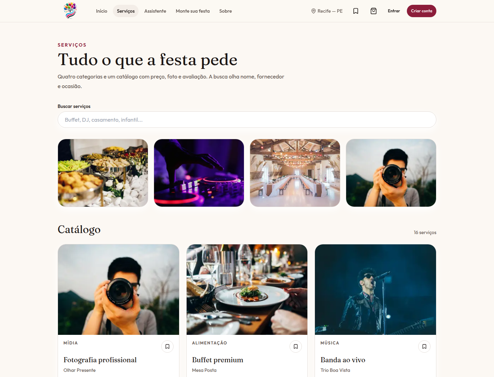
</p>

Assistente em conversa (modo demonstração, sem chave de modelo) e a busca direta.

<p>
  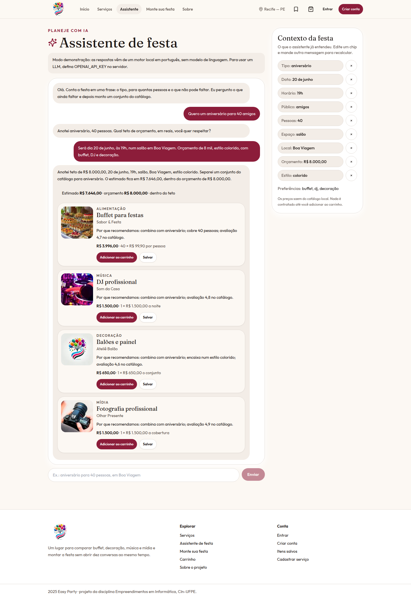
  
</p>

Descrever a festa e ver sugestões. Sem a API de recomendação, o resultado vem do catálogo local.

<p>
  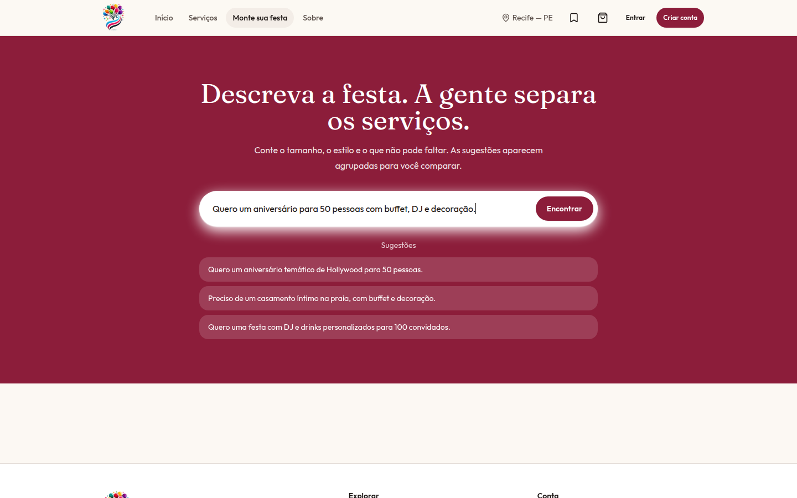
  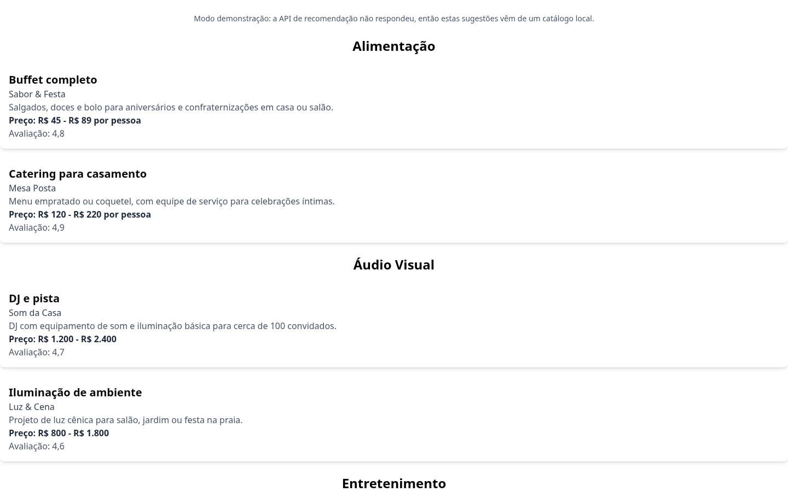
</p>

Categoria, página do serviço, carrinho e pagamento.

<p>
  
  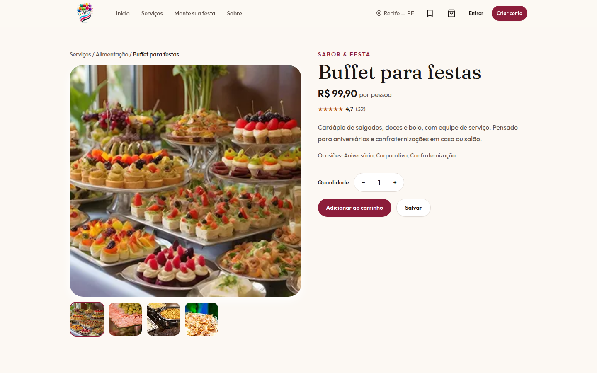
</p>
<p>
  
  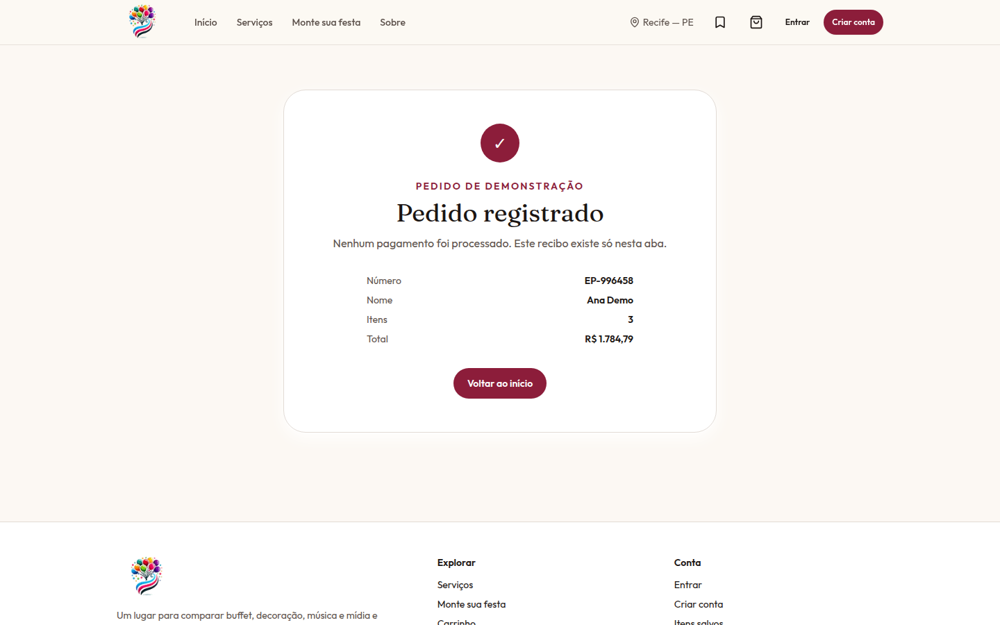
</p>

Login em modo demonstração, sessão avisada no topo, sobre o projeto e a lista de salvos.

<p>
  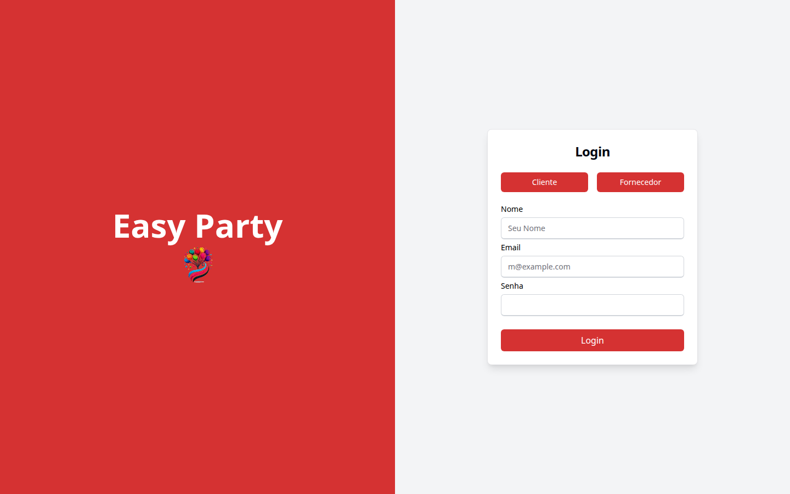
  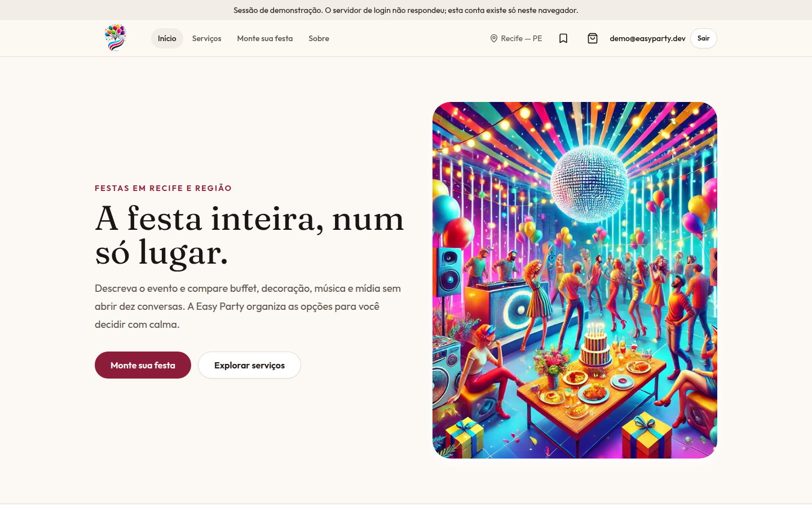
</p>
<p>
  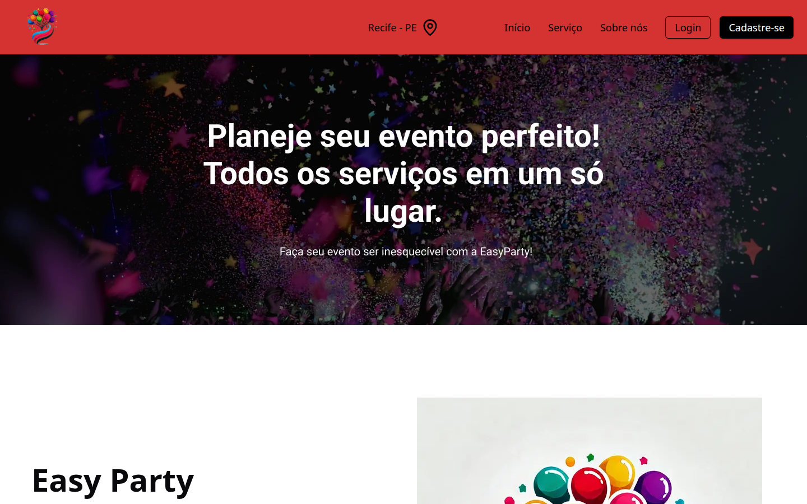
  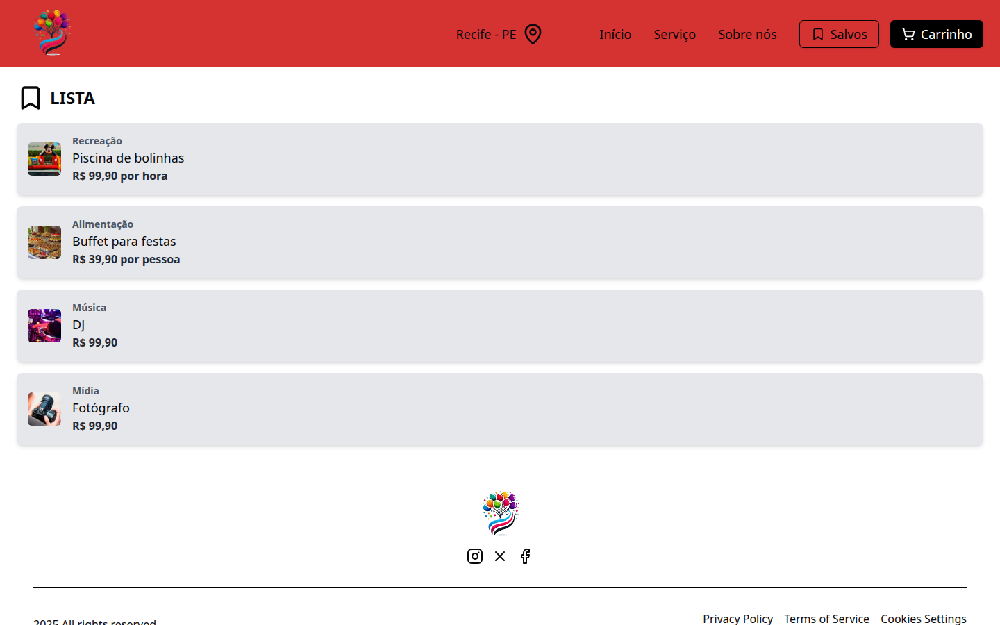
</p>

Celular: início, catálogo e carrinho.

<p>
  
  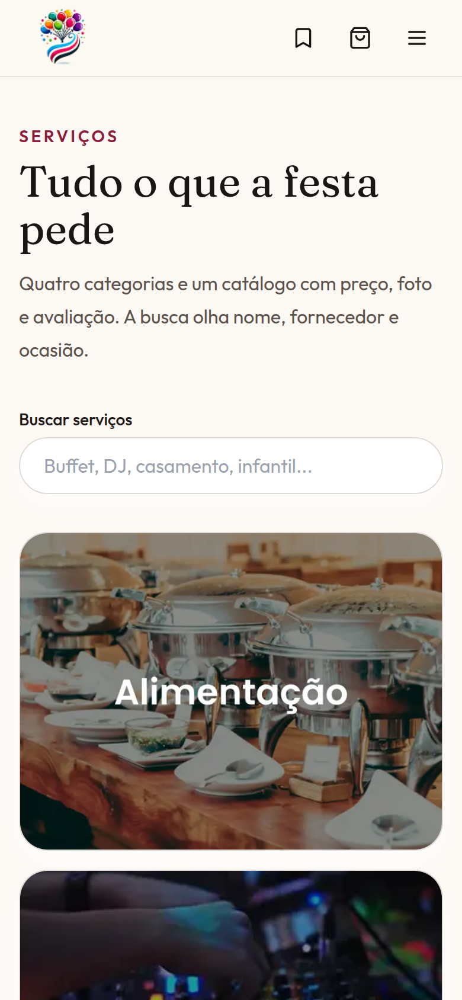
  
</p>

## Stack

| Camada | Escolha |
| --- | --- |
| App | Next.js 14 (App Router) e React 18 |
| Linguagem | TypeScript |
| Estilo | Tailwind CSS e componentes no estilo shadcn/ui (Radix) |
| Formulários | React Hook Form e Zod |
| HTTP | Axios |
| Sessão | NextAuth (Credentials). Sem a API, a sessão é local e marcada como demonstração |
| Testes | Jest e Testing Library (esqueleto do boilerplate) |

## Como rodar

Pré-requisito: Node.js 20+ e [Yarn](https://classic.yarnpkg.com/).

```bash
git clone https://github.com/iianmelo/easy-party-front.git
cd easy-party-front
cp .env.example .env
yarn install
yarn dev
```

Abra [http://localhost:3000](http://localhost:3000).

Variáveis em `.env` (há valores de exemplo em `.env.example`):

| Variável | Para que serve |
| --- | --- |
| `NEXTAUTH_URL` | URL da aplicação. Local: `http://localhost:3000`. |
| `NEXTAUTH_SECRET` | Segredo do NextAuth. Se faltar, o modo local usa um segredo de demonstração. |
| `NEXT_PUBLIC_API_URL` | Base da API. Padrão: `http://localhost:5000`. |

A recomendação de “Monte sua festa” chama `POST /getData`. O login chama `POST /sessions`. Se essa API não estiver no ar, “Monte sua festa” usa o catálogo em `src/services/getServices.ts` e o login entra em modo demonstração. Carrinho e salvos ficam no `localStorage`.

### Assistente com um modelo de verdade

O chat em `/assistente` chama `POST /api/assistant`. Sem `OPENAI_API_KEY`, a rota usa o motor local e a página mostra **modo demonstração**. Com a chave, a rota fala com uma API compatível com OpenAI (ferramenta `atualizar_plano`, saída em JSON) e o servidor recalcula os preços pelo catálogo. A chave não vai para o browser.

```bash
OPENAI_API_KEY=sk-...
OPENAI_BASE_URL=https://api.openai.com/v1   # opcional
OPENAI_MODEL=gpt-4o-mini                     # opcional
```

Se a chamada ao modelo falhar, o mesmo fluxo cai de volta no motor local.

Outros comandos:

```bash
yarn lint
yarn typecheck
yarn build
yarn start
```

## Estrutura

```text
src/app/            rotas (início, serviços, festa, carrinho, pagamento, login)
src/components/     barra, cards, páginas de catálogo
src/data/catalog.ts serviços, preços e categorias
src/providers/      carrinho, salvos e sessão
src/services/       cliente HTTP e recomendação, com catálogo local
src/assets/         imagens do produto
docs/screenshots/   capturas usadas neste README
```

## Time e contexto

Projeto de equipe na disciplina **Empreendimentos em Informática**, do Centro de Informática da UFPE (**CIn-UFPE**), de fevereiro a maio de 2025. Ian cursa **Engenharia da Computação** no CIn-UFPE.

O time, como aparece na página Sobre:

| Pessoa | No produto |
| --- | --- |
| Rafael Alves | Desenvolvedor de Software |
| João Fellows | Desenvolvedor de Software |
| Guilherme Montenegro | Desenvolvedor de Software |
| Victor Mendonça | Desenvolvedor de Software |
| Ian Medeiros Melo | Desenvolvedor de Software |

## Meu papel

> **Ian, preencha esta seção com o que foi seu.** O restante do README não descreve a sua contribuição individual de propósito.

Vale escrever, só com o que você realmente fez:

- o que você construiu, integrou ou organizou (telas, fluxo, API, rituais do time);
- uma decisão de produto ou de processo que tenha sido sua;
- um resultado concreto, se houver. Não invente métrica, prazo ou cargo.

## Links

- Repositório: [github.com/iianmelo/easy-party-front](https://github.com/iianmelo/easy-party-front)
- LinkedIn: [Ian Melo](https://www.linkedin.com/in/ian-melo-2340312a8/)

Não há deploy público neste repositório. O workflow `.github/workflows/deploy.yml` publica a branch `main` em Dokku com segredos do CITi (`HOST` e `CITI_PRIVATE_KEY`); a homepage do GitHub está vazia, então não há URL de demonstração para colocar aqui.

## Limites do MVP

- Sem a API, login e cadastro criam uma sessão só neste navegador. O topo avisa que é demonstração.
- O pagamento não cobra nada. A confirmação fica na aba, em `sessionStorage`.
- Parte das fotos de música, decoração e mídia reaproveita imagens que já estavam no repositório.
- Os depoimentos da home são fictícios e estão rotulados assim. Não são métricas do projeto.
