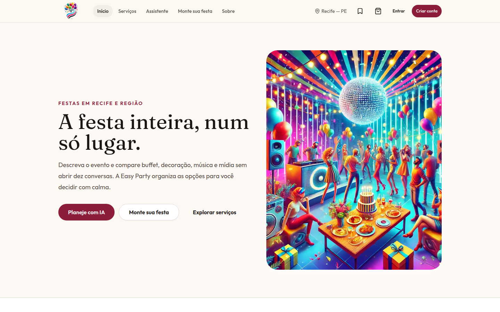
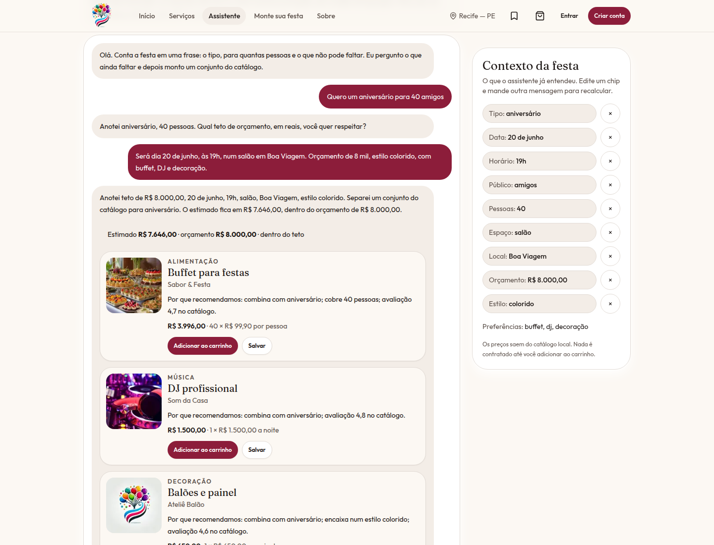
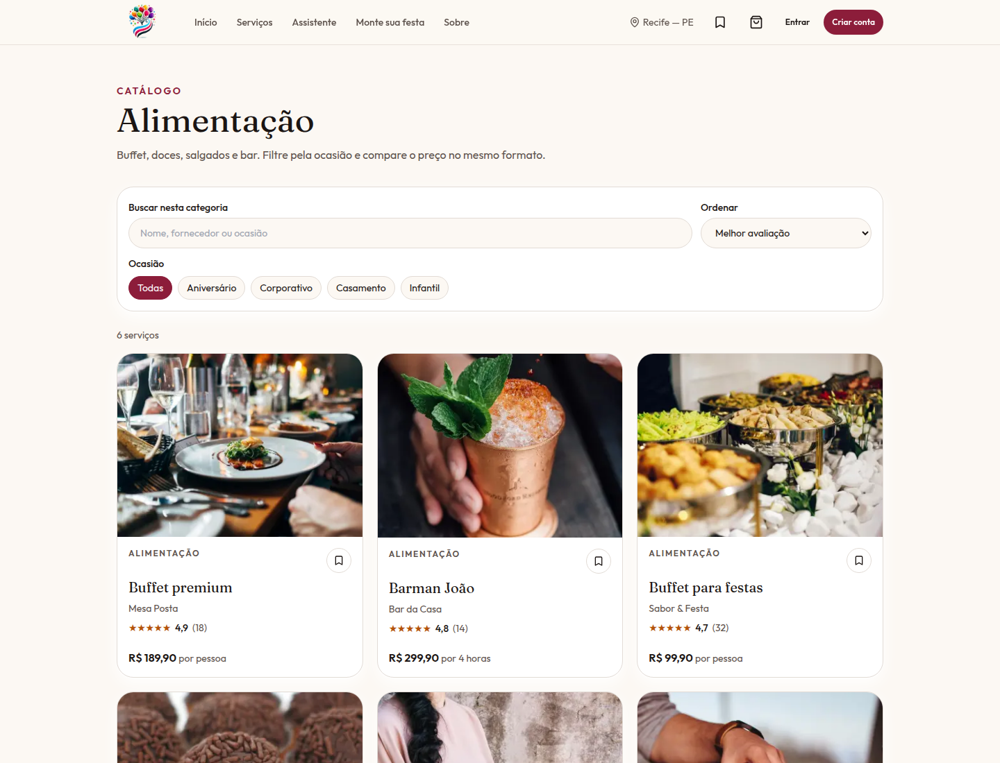
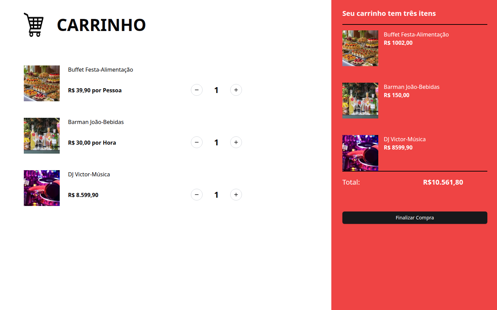
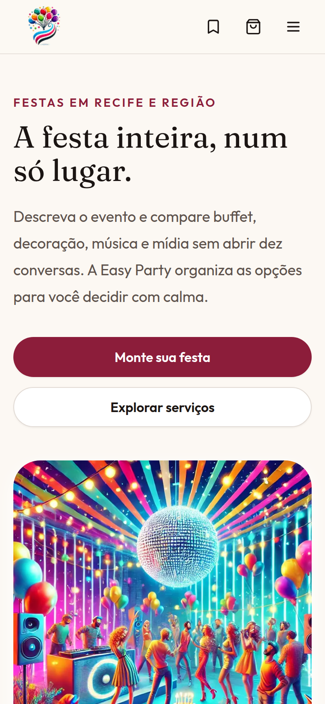
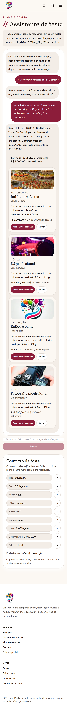
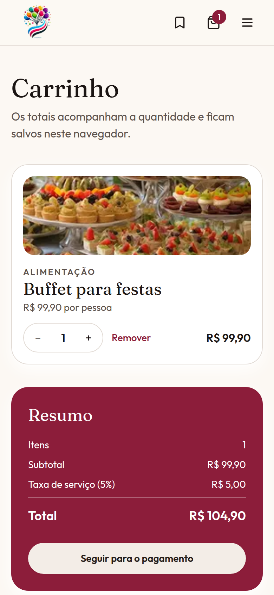

<p align="center">
  
</p>

<h1 align="center">Easy Party</h1>

<p align="center">
  
  
  
  
  
</p>

<p align="center"><strong>Monte a festa inteira a partir de uma conversa.</strong></p>

MVP de uma plataforma para organizar festas em Recife e região: catálogo de buffet, música, decoração e mídia, carrinho e um assistente que recomenda serviços do próprio catálogo. O fluxo abre no navegador sem backend.

*English:* a party-planning MVP — describe the event, compare suppliers, and get catalog recommendations.

## Sumário

- [Sobre o projeto](#sobre-o-projeto)
- [Funcionalidades](#funcionalidades)
- [Capturas](#capturas)
- [Tecnologias](#tecnologias)
- [Como rodar](#como-rodar)
- [Estrutura do projeto](#estrutura-do-projeto)
- [Time e contexto](#time-e-contexto)
- [Meu papel](#meu-papel)
- [Próximos passos](#próximos-passos)
- [Links](#links)

## Sobre o projeto

Quem organiza aniversário, casamento íntimo ou confraternização pequena decide comida, som, decoração e registro ao mesmo tempo. Cada fornecedor aparece num canal diferente, e o orçamento só fecha no fim.

A Easy Party concentra essas peças. A pessoa descreve a festa, compara serviços no mesmo formato e vê um conjunto com preço antes de chamar todo mundo.

O público, no recorte do MVP, está em Recife e região: quem planeja a própria festa e quem oferece buffet, decoração, música ou foto.

O produto nasceu na disciplina **Empreendimentos em Informática**, no Centro de Informática da UFPE (**CIn-UFPE**), de fevereiro a maio de 2025.

## Funcionalidades

Tudo abaixo funciona sem servidor próprio. Onde a tela depende de uma API externa, o app avisa que está em modo demonstração.

- **Início** com a proposta, os três passos e categorias. Os depoimentos são fictícios e estão rotulados assim.
- **Catálogo** de alimentação, música, decoração e mídia, com busca, filtro por ocasião e ordenação.
- **Página do serviço** com fotos, preço, avaliação, quantidade, carrinho e lista.
- **Assistente de festa** ([Planeje com IA](#como-rodar)): a conversa junta tipo, data, horário, público, tamanho, idade, espaço, cidade, orçamento e estilo. Quando há contexto suficiente, recomenda serviços do catálogo, com o motivo, o total estimado contra o teto e ações de carrinho e salvos. Um painel lateral mostra o que foi entendido, em chips editáveis.
- **Monte sua festa:** um pedido em texto livre e sugestões agrupadas. Sem a API, entra um catálogo local.
- **Carrinho** com quantidade, subtotal, taxa e total neste navegador.
- **Pagamento** de demonstração e tela de pedido registrado. Nenhum valor é cobrado.
- **Salvos**, guardados no navegador.
- **Login e cadastro** de cliente ou fornecedor. Se a API de sessão não responder, a entrada fica marcada no topo como demonstração.
- **Sobre** com o time e um formulário de empresa que não sai do navegador.

## Capturas

<table>
  <tr>
    <td align="center" width="50%">
      <br />
      <sub>Início</sub>
    </td>
    <td align="center" width="50%">
      <br />
      <sub>Assistente de festa</sub>
    </td>
  </tr>
  <tr>
    <td align="center" width="50%">
      <br />
      <sub>Catálogo</sub>
    </td>
    <td align="center" width="50%">
      <br />
      <sub>Carrinho</sub>
    </td>
  </tr>
</table>

<p align="center">
  
  
  
</p>

<p align="center"><sub>Celular: início, assistente e carrinho.</sub></p>

Outras telas, no tamanho original:

| Desktop | |
| --- | --- |
| [Serviços](docs/screenshots/servicos-desktop.png) | [Página do serviço](docs/screenshots/produto-desktop.png) |
| [Monte sua festa](docs/screenshots/criar-festa-desktop.png) | [Sugestões da festa](docs/screenshots/criar-festa-resultados-desktop.png) |
| [Assistente, conversa inteira](docs/screenshots/assistente-desktop.png) | [Pagamento](docs/screenshots/pagamento-desktop.png) |
| [Pedido registrado](docs/screenshots/pagamento-sucesso-desktop.png) | [Salvos](docs/screenshots/salvos-desktop.png) |
| [Login](docs/screenshots/login-desktop.png) | [Sessão de demonstração](docs/screenshots/sessao-demo-desktop.png) |
| [Sobre](docs/screenshots/sobre-desktop.png) | [Time](docs/screenshots/sobre-time-desktop.png) |

| Celular | |
| --- | --- |
| [Serviços](docs/screenshots/servicos-mobile.png) | [Página do serviço](docs/screenshots/produto-mobile.png) |

## Tecnologias

| Camada | Escolha |
| --- | --- |
| Aplicação | Next.js 14 (App Router) e React 18 |
| Linguagem | TypeScript |
| Interface | Tailwind CSS, Radix e componentes no estilo shadcn/ui |
| Formulários | React Hook Form e Zod |
| HTTP | Axios |
| Sessão | NextAuth (Credentials), com fallback local |
| Assistente | Rota `POST /api/assistant`. Com `OPENAI_API_KEY`, API compatível com OpenAI. Sem a chave, motor local em português |

## Como rodar

É preciso Node.js 20+ e [Yarn](https://classic.yarnpkg.com/).

```bash
git clone https://github.com/iianmelo/easy-party-front.git
cd easy-party-front
cp .env.example .env
yarn install
yarn dev
```

Abra [http://localhost:3000](http://localhost:3000). O assistente está em [http://localhost:3000/assistente](http://localhost:3000/assistente).

```bash
yarn lint
yarn typecheck
yarn build
yarn start
```

### Variáveis

O arquivo [`.env.example`](.env.example) lista todas. Nenhuma chave vai para o browser.

| Variável | Uso |
| --- | --- |
| `NEXTAUTH_URL` | URL da aplicação. Local: `http://localhost:3000`. |
| `NEXTAUTH_SECRET` | Segredo do NextAuth. Se faltar, o modo local usa um segredo de demonstração. |
| `NEXT_PUBLIC_API_URL` | Base da API de “Monte sua festa” e do login. Padrão: `http://localhost:5000`. |
| `OPENAI_API_KEY` | Chave do assistente. Só no servidor. Sem ela, o chat fica em modo demonstração. |
| `OPENAI_BASE_URL` | Opcional. Padrão: `https://api.openai.com/v1`. |
| `OPENAI_MODEL` | Opcional. Padrão: `gpt-4o-mini`. |

### Modo demonstração

Sem as APIs externas, o site continua percorrível:

- **Assistente.** `POST /api/assistant` lê a mensagem em português, preenche o contexto e escolhe itens do catálogo. A tela diz que é modo demonstração. Com `OPENAI_API_KEY`, a mesma rota pede ao modelo a ferramenta `atualizar_plano` (JSON) e o servidor recalcula os preços. Se a chamada falhar, volta ao motor local.
- **Monte sua festa.** `POST /getData` na `NEXT_PUBLIC_API_URL`. Fora do ar, usa o catálogo em `src/services/getServices.ts`.
- **Login.** `POST /sessions`. Fora do ar, qualquer e-mail e senha criam uma sessão só neste navegador, avisada no topo.
- **Carrinho e salvos** ficam no `localStorage`. O recibo do pagamento fica no `sessionStorage` e não cobra nada.

## Estrutura do projeto

```text
src/app/                  rotas (início, catálogo, assistente, carrinho, pagamento, login)
src/app/api/assistant/    chat do assistente
src/components/           barra, cards, catálogo, estados vazios
src/data/catalog.ts       serviços, preços e categorias
src/lib/                  motor local do assistente e formatação
src/providers/            carrinho, salvos e sessão
src/services/             cliente HTTP e a outra recomendação, com catálogo local
src/assets/               imagens
docs/screenshots/         capturas deste README
```

## Time e contexto

Trabalho em equipe na disciplina Empreendimentos em Informática, CIn-UFPE, de fevereiro a maio de 2025. Ian Medeiros Melo cursa Engenharia da Computação no CIn-UFPE e está em transição para PMO e gestão de projetos.

Na página Sobre, o time aparece assim:

| Pessoa | No produto |
| --- | --- |
| Rafael Alves | Desenvolvedor de Software |
| João Fellows | Desenvolvedor de Software |
| Guilherme Montenegro | Desenvolvedor de Software |
| Victor Mendonça | Desenvolvedor de Software |
| Ian Melo | Desenvolvedor de Software |

Os nomes e o papel de cada card são os que estão na aplicação. Links de LinkedIn e Instagram saem desses cards.

## Meu papel

> **Ian, esta seção é sua.** O restante do README não descreve a sua contribuição individual.

Escreva só o que você fez de fato:

- o que construiu, integrou ou organizou;
- uma decisão de produto ou de processo que tenha sido sua;
- um resultado concreto, se houver.

Não invente métrica, prazo ou cargo.

## Próximos passos

- Ligar fornecedores e login a uma API persistente, no lugar dos fallbacks locais.
- Trocar o checkout de demonstração por um pagamento real.
- Publicar um deploy. O workflow em `.github/workflows/deploy.yml` aponta para Dokku e depende de segredos que este repositório não traz.
- Completar fotos próprias nas categorias que ainda reaproveitam imagem.
- Cobrir os fluxos atuais com testes. O que veio no template não exercita o produto de hoje.

## Links

- Repositório: [github.com/iianmelo/easy-party-front](https://github.com/iianmelo/easy-party-front)
- LinkedIn: [Ian Melo](https://www.linkedin.com/in/ian-melo-2340312a8/)
- Aplicação local: [localhost:3000](http://localhost:3000) e [assistente](http://localhost:3000/assistente)

Não há URL pública de demonstração. A homepage do GitHub está vazia.
